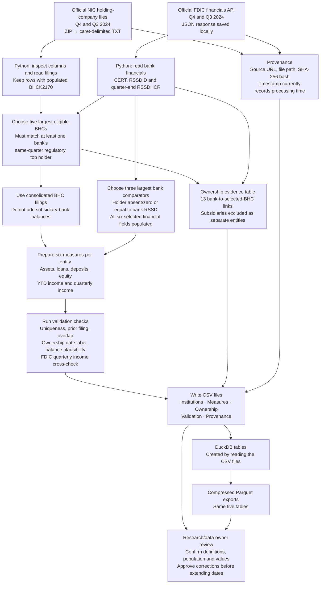
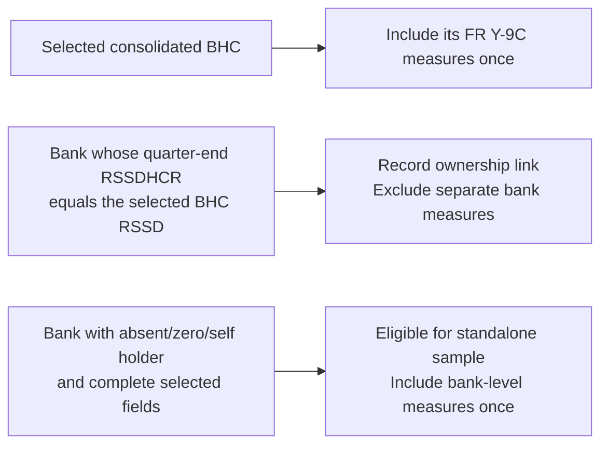

# BPI MVP — workflow and logic review

Prepared for discussion with the research/data owner. This describes the implemented prototype, checked against `src/bpi_pipeline.py`, rather than the intended future system.

**Current scope:** 31 December 2024, using 30 September 2024 for income conversion. Five consolidated holding companies, three bank comparators, 48 measure rows and 13 subsidiary ownership links. Amounts are USD thousands.

## 1. Architecture map

**Important:** validation is currently a report, not a release gate. The program writes outputs even if a check fails. DuckDB is the output/query layer; Python performs the selection and transformations.

## 2. What happens to each measure?

| Final measure | Consolidated holding company | Standalone bank comparator | Treatment |
|---|---|---|---|
| Assets | `BHCK2170` | `ASSET` | Quarter-end stock; use directly |
| Loans | `BHCK2122` | `LNLSNET` | Quarter-end stock; definitions need harmonisation review |
| Deposits | `BHDM6631 + BHDM6636 + BHFN6631 + BHFN6636` | `DEP` | Sum BHC domestic/foreign components; use bank total directly |
| Equity | `BHCK3210` | `EQ` | Quarter-end stock; confirm equivalent equity perimeter |
| YTD net income | `BHCK4340` | `NETINC` | Preserve cumulative calendar-year amount |
| Quarterly net income | Current `BHCK4340` minus prior-quarter `BHCK4340` | `NETINCQ` | Q1 BHC income uses YTD directly; bank quarterly field checked against YTD difference |

For example, BHC Q4 income = December YTD income − September YTD income. A missing prior income value yields a missing quarterly result. These are as-reported flows; a merger or accounting-perimeter change can affect comparability.

**Definition issue to resolve:** BHC `BHCK2122` is loans and leases net of unearned income; FDIC `LNLSNET` is net loans and leases. They share the current output label `total_loans`, but should not be assumed equivalent for research without approving a common definition.

## 3. How double counting is avoided

The pipeline matches identifiers, rather than names. BHC filings are linked across quarters by RSSD; bank income is linked by FDIC certificate. Ownership uses the current quarter's FDIC high-holder field. This captures a quarter-end relationship, not the complete path through intermediate companies.

**Qualification:** an absent holder identifier is currently treated as standalone eligibility. Missing ownership information alone does not establish independence; the owner should confirm these sample institutions and the proposed rule.

## 4. What the current checks establish

| Check | Current result | What still requires review |
|---|---|---|
| Unique analytical entity and period | Pass: 8 rows | Does not test uniqueness of every raw input or measure key |
| Prior BHC record available | Pass | Does not independently verify adjacent quarter dates or that prior income is populated |
| Selected BHC/subsidiary overlap | Pass | Depends on the correctness and completeness of high-holder identifiers |
| Ownership period | Pass: 13 links | Current check compares assigned output labels; it does not independently check raw report dates |
| Balance plausibility | Pass | Loans, deposits and equity must be nonnegative and ≤105% of assets; missing values are allowed. This is not an accounting reconciliation |
| Bank quarterly income | Pass: 3 of 3 | Compares NETINCQ with the YTD difference where prior records are available |
| Overall summary | Pass | Summarises the six checks above; it is not an additional independent test |

Five unit tests cover Q1 conversion, non-Q1 subtraction, missing prior income and deposit summation/missingness. Passing these tests does not independently certify the financial values.

## 5. Questions for the person in charge

1. **Research population:** should the dataset represent consolidated banking groups plus independently operating banks? Are the mechanically selected five BHCs and three banks appropriate, or should we use a fixed research list?
2. **Loan definition:** should loans be before or after allowances, and include loans held for sale? Approve one definition for both sources and the required mapping.
3. **Equity and income:** confirm the desired treatment of noncontrolling interests and other differences in reporting perimeter.
4. **Ownership:** approve quarter-end high-holder matching for the MVP and independently confirm the standalone status of Zions, Cadence and Bank OZK for this quarter.
5. **Missing deposits:** the current BHC sum treats an individual missing component as zero if another component is populated. Should missing components instead produce an exception pending review?
6. **Data acceptance:** agree reconciliation checks, materiality thresholds and a reference filing for each sample institution. Decide which failures should stop publication.
7. **Historical policy:** use as-reported entities initially, or require a documented merger-adjustment methodology before comparisons across structural changes?

## 6. Concrete review package

Current sample: JPMorgan Chase, Bank of America, Citigroup, Wells Fargo and Goldman Sachs; Zions Bancorporation N.A., Cadence Bank and Bank OZK.

Open these files together from `outputs/20241231/`:

- `institutions.csv`: confirm the 8 entities and identifiers.
- `measures.csv`: inspect the 48 values and their source variables.
- `ownership.csv`: inspect the 13 excluded subsidiary links.
- `validation.csv`: review the checks and their scope.
- `provenance.csv`: identify the four input files and hashes.

Recommended sign-off evidence: independently reconcile all six measures for at least one BHC and one standalone bank to their official filings, then review the remaining sample with the approved definitions.

## 7. Implementation gaps before extension

- Verify raw report dates, preceding-quarter adjacency, API response completeness and duplicate input identifiers.
- Strengthen missing-value handling, standalone classification and cross-source measure comparability.
- Store actual download times, complete API request parameters and source revision information. The current `retrieved_at_utc` is generated during processing and is not proof of the original download time.
- Turn agreed validation failures into a publication gate and expand tests around the selection and ownership rules.
- The measure-map CSV documents the logic; the implementation currently hardcodes it in Python. Changes must be kept aligned until a versioned mapping loader is added.
- Review the FFIEC CDR bulk files directly if raw Call Report schedule ingestion is required. The implemented bank branch currently uses FDIC financials rather than parsing CDR schedule files.
- No historical merger adjustment has been implemented. Extend to 2023–2025 only after agreeing the definitions and acceptance criteria above.

**Review outcome to record:** approved population; approved measure definitions; ownership rule; missing-data rule; reference reconciliation results; required fixes; reviewer and date.
